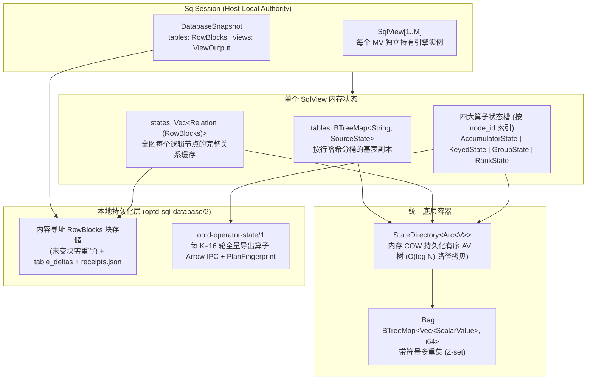
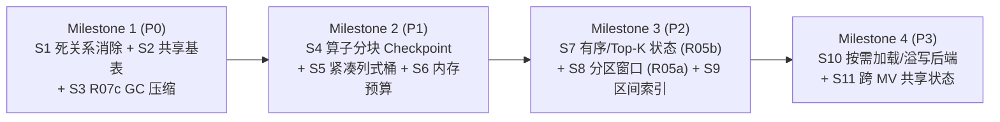

# RFC: 增量计算引擎状态（State）管理现状分析与演进路线

* **状态：** Draft（现状盘点与优化提案）
* **日期：** 2026-11-22
* **范围：** `optd-incremental-sql`（内存状态容器、算子状态家族、块级持久化、算子状态 Checkpoint 与恢复）
* **相关文档：**
  * [Shared State Directories](./shared_state_directories.md)
  * [Chunked Maintained Relations](./chunked_relation_caches.md)
  * [Block-Level Checkpoints and Delta Logs](./block_checkpoints.md)
  * [Persistent Operator State and Bounded-Replay Recovery](./persistent_operator_state.md)
  * [Incremental Plan Text EXPLAIN & TPC-H / TPC-DS Catalog](./tpc_incremental_plans.md)

---

## 1. 背景与目标

在完成 Wave 1（`R09b` 预编译执行模板、`R07a` 块级 Checkpoint、`R07b` 持久化算子状态与有界重放、`R10a` 65k 扩展回归）后，`optd-incremental-sql` 已打通 **“增量规划 → 增量执行 → 块级提交 → 算子状态持久化 → 崩溃有界重放恢复”** 的端到端闭环，且在 `relational_core` 模式下实现 **TPC-H 22/22、TPC-DS 99/99 全部 100% 严格增量编译**。

随着视图复杂度（多表 Join、窗口、多视图共享基表）与数据/基数规模扩大，**状态（State）管理**成为决定内存占用、Checkpoint 写放大、重启延迟以及 `original` SQL 覆盖率的核心瓶颈。本 RFC 系统盘点当前全部状态层的真实实现，识别已暴露的架构瓶颈，并提出分阶段、可验证的优化 TODO。

---

## 2. 当前状态管理架构现状

当前 `optd-incremental-sql` 状态子系统共约 **7.3k LOC**，呈现 **“统一持久化 AVL 目录 + 六大内存状态域 + 两层磁盘持久化协议”** 的分层结构：

### 2.1 底层通用容器：`StateDirectory<V>`

* **源码**：`optd-incremental-sql/src/state_directory.rs`（583 LOC）
* **实现**：基于 `Option<Arc<Node<V>>>` 的内存持久化有序 AVL 树，键为规范字节串 `Vec<u8>`，值为 `Arc<Payload>`。
* **核心特性**：
  * **事务/候选隔离**：`clone()` 为 $O(1)$（仅增加根节点 `Arc` 计数，并重置候选拷贝统计）；
  * **路径拷贝（COW）**：`insert` / `remove` 借助 `Arc::try_unwrap` 仅拷贝从根到目标叶子的 $O(\log N)$ 路径节点与旋转兄弟节点，其余子树零拷贝共享；
  * **有序导航**：提供 `get`、`predecessor`、`successor`、`first_key_value`、`last_key_value`，同时服务块路由、极值查找与秩后缀跳转。

### 2.2 六大内存状态域盘点

| 状态域 | 源码与规模 | 底层结构 | 保留的数据内容 | 适用场景 |
| --- | --- | --- | --- | --- |
| **1. 基表原始状态 `SourceState`** | `source_state.rs` (382 LOC) | `StateDirectory<Arc<Bag>>`（按 `u64` 行哈希分桶）+ 懒展平 `Mutex<Option<Bag>>` | 基表全部带权重行，绕过 Arrow 编码预算以支持超大权重 | 事务前缀溢出检查、净变更合并与按需 `SourceRead` |
| **2. 块级关系状态 `RowBlocks`** | `row_blocks.rs` (1,279 LOC) | `StateDirectory<Arc<RowBlock>>`（每叶最多 `BLOCK_ENTRIES = 256` 去重行） | 按 Arrow `RowConverter` 键有序分块的 `Bag` + 进程内 `BlockUid` + 懒加载 `Mutex<Option<RecordBatch>>` | 基表快照（`TableRows`）、**全图每个中间节点 `SqlView.states[id]`**、无序 MV 输出 |
| **3. 可回撤累加器 `AccumulatorState`** | `accumulator_state.rs` + `aggregate_cell.rs` / `moments.rs` / `value_index.rs` (1,597 LOC) | `StateDirectory<Arc<Entry>>`（按编码分组键） | 仅存摘要（`rows`、`keys`、`output`、`Vec<Cell>`），**不保留历史明细行**；`Cell` 支持 Native Accumulator、精确整数 `AVG`、`ValueIndex`（`MIN/MAX`）、`Distinct` 引用计数、`Moments`（`STDDEV`） | `AccumulatorDelta`（TPC-H 29 处、TPC-DS 258 处） |
| **4. 键值索引 `KeyedState`** | `keyed_state.rs` + `match_join/` (1,258 LOC) | `inputs: Vec<StateDirectory<Arc<Bucket>>>` + 可选 `ResidualState` + 窗口 `outputs: StateDirectory<Arc<Bag>>` | 按 Join 键或窗口分区键聚合输入行；**每 `Bucket` 同时存 `Bag` 与 `RecordBatch`**；残余条件连接额外维护匹配计数；窗口保存已提交输出以防 tie 漂移 | `IndexedDelta`（TPC-H 51 / TPC-DS 521）、`MatchCountDelta`（12 / 106）、`KeyedRecompute`（0 / 18） |
| **5. 分组重算状态 `GroupState`** | `group_state.rs` (919 LOC) | `StateDirectory<Arc<GroupBucket>>` | 每组保留完整历史 `input: Bag` 与上次 `output: Bag` | `ChangedGroupRecompute`（无法直接累加回撤的分组聚合） |
| **6. 全局排序秩 `RankState`** | `rank_state.rs` (391 LOC) | `StateDirectory<Arc<Peer>>`（按 `ORDER BY` 排序键） | 每个等值 peer 组的 `rows: Bag`、`count`、`rank`，结合前驱计数实现后缀增量更新 | `RankDelta`（全局 `RANK()`，如 TPC-DS Q44 / Q49 共 8 处） |

### 2.3 持久化与崩溃恢复现状（`optd-sql-database/2` + `optd-operator-state/1`）

* **增量块存储（每次提交 $O(|\Delta|)$）**：
  * 基表与无序 MV 的 `RowBlocks` 通过 `BlockUid` 识别脏叶，仅将变更块写入内容寻址 Arrow 文件，未变块跨 epoch 复用；`manifest.json` 存固定 64 字符 `min_key_sha256`；提交过程零全表展平（`table_materialization == 0`）。
  * 每次提交持久化当轮 `table_deltas`（每张变更基表的净增量）与增量维护的 `receipts.json`（O(1) 幂等重试查询）。
* **周期性算子状态 Checkpoint（默认 `K = 16` 次受影响提交）**：
  * `state_codec.rs`（874 LOC）将 `SqlView` 的全部 `node_relations`（经块存储去重）和四大算子状态按列导出为 Arrow IPC 文件 + JSON 清单，并绑定确定性 `PlanFingerprint`（覆盖 SQL、依赖表 Schema、规则版本与物理程序）。
* **重启有界重放恢复（`SqlSession::open_with_options`）**：
  * 从最近一次算子状态 checkpoint 加载算子内存状态与 `node_relations`；
  * 通过聚合待重放的 `table_deltas` 并与 head 基表做差（$B_{\text{ckpt}} = B_{\text{head}} \ominus \sum \Delta_i$）反推出 checkpoint 时刻的 `SourceState`（避免冗余存储基表快照）；
  * 最多重放 `K - 1` 轮 `table_deltas` 追平至 head；若 `PlanFingerprint` 不匹配或文件损坏，严格按 `IncompatibleStatePolicy::{Fail, Rebuild}` 处理。

---

## 3. 现状核心痛点与瓶颈（代码实证）

虽然 Wave 1 解决了“每次提交重写全表”和“重启全量扫描基表重建”两大根本痛点，但以下 **6 类结构性瓶颈** 仍然显著制约内存效率、长稳运行与大规模场景：

### 瓶颈 1：全图无条件物化 `SqlView.states: Vec<Relation>`（严重内存与 Checkpoint 放大）
* **现状**：`SqlView` 为逻辑 DAG 中的**每一个节点**（`0..nodes.len()`）都维护一份完整的 `Relation(RowBlocks)`，并在刷新时逐节点更新、在 checkpoint 时通过 `export_view_parts` 全部导出。
* **实证影响**：在 TPC-H（356 节点）与 TPC-DS（3,311 节点）中，**72.5%–74.2%** 的节点是纯线性 `NativeDelta` 算子（`TableScan` / `Filter` / `Projection` / `SubqueryAlias`），下游只消费其 `DeltaRead(#id)`，**从未读取过它的 `SnapshotRead` / `Replace`**。维护并持久化这些死关系缓存导致约 **3×–5× 的无谓内存占用、块更新开销与状态清单膨胀**。

### 瓶颈 2：跨视图基表冗余拷贝与内存表示膨胀
* **多份基表拷贝**：同一张基表在 `DatabaseSnapshot.tables` 中存一份 `RowBlocks`，在每个引用该表的 `SqlView.tables` 中又各自维护一份独立的 `SourceState`（含完整行 `Bag`）。当数据库建立 $M$ 个物化视图时，基表内存呈 $O(M \cdot |T|)$ 线性倍增。
* **`Bucket` 双份存储**：`KeyedState::Bucket` 对每个 Join/窗口桶同时持有 `bag: Bag` 和 `batch: RecordBatch`（即便对于无需保留输入顺序的等值内连接也是如此），直接翻倍 Join 状态内存。
* **`Bag` 的 `ScalarValue` 堆膨胀**：`Bag` 底层为 `BTreeMap<Vec<ScalarValue>, i64>`，每行都是 `Vec<ScalarValue>`，每个列值是一个独立枚举（字符串/小数等再套堆分配），相比紧致列式 Arrow Buffer 内存开销大 5×–20×，且与 DataFusion 执行层之间存在持续的行↔列转换开销。

### 瓶颈 3：算子状态 Checkpoint 为整算子全量重写，且重启必须全量常驻内存
* **写放大**：与 `RowBlocks` 的脏块增量写盘不同，`state_codec::write_operator_states` 在每第 `K` 次提交时，会将 `AccumulatorState`、`KeyedState`、`GroupState`、`RankState` **整算子全量重写为新 Arrow IPC 文件**（写放大为 $O(|S|)$）。若 Join 或聚合状态包含数百万个 key，单次 checkpoint 会造成明显毛刺。
* **冷启动与内存天花板**：`SqlSession::open` 必须将所有算子状态一次性反序列化进内存 `StateDirectory`，尚不支持“磁盘按需点查（On-Disk Point Lookup）”或超内存溢写（Spill-to-Disk），因此无法承载超过单机内存的高基数聚合或超大表多路 Join。

### 瓶颈 4：缺少历史保留策略与 GC 压缩（`R07c` 未闭环）
* **现状**：`optd-sql-database/2` 的每次提交都会追加新 manifest、新块文件、`table_deltas` 与周期性算子状态目录，目前**没有任何清理/压缩机制**。
* **风险**：在持续写入场景下，历史文件数量与磁盘空间无限增长，同时 `verify_output_history` 与目录扫描元数据开销随 epoch 线性恶化。

### 瓶颈 5：缺失关键算子状态家族，制约 `original` SQL 覆盖与窗口效率
* **有序状态与 Top-K（`R05b`）**：TPC-H 18/22 与 TPC-DS 94/99 在 `original` 模式下 100% 仅因 `Sort` / `Limit` 退化为 `OperatorRecompute` 而被严格模式拒绝。
* **分区窗口专用增量状态（`R05a`）**：TPC-DS 中 13 条查询（18 个窗口节点）目前使用 `KeyedRecompute`，每次分区内单行变更都要重算整个分区快照。
* **非等值 Join 区间索引（`R04c`）**：尚无区间树/范围索引状态支撑 `< / <= / BETWEEN` 等非等值连接。

### 瓶颈 6：缺乏统一状态内存预算、可观测性与反压机制
* 当前仅有单批物化上限（`MAX_MATERIALIZED_ROWS` / `MAX_MATERIALIZED_BYTES`），尚无**跨算子/跨视图的常驻状态内存统计**（每个状态的条目数、估算字节数、磁盘文件数），也缺乏 `EXPLAIN` 级状态画像与内存上限熔断。

---

## 4. 优化路线与工程 TODO

按 **投入产出比（ROI）与架构依赖关系** 划分为 4 个优先级波次（P0 → P3）：

### P0：高 ROI 减负与存储闭环（零格式破坏或小步演进）

* [x] **TODO-S1：按需中间关系物化（Dead Relation State Elimination）** *(已落地：`4dd466d`)*
  * **方案**：在 `IncrementalPlan` 编译期做静态可达性分析——仅当节点 `#id` 是视图根节点，或被任一下游 `CompiledProgram` 的 `SnapshotRead` / `SnapshotReadWhenChanged` / `Replace` 引用，或为 `Ordered` 语义所需时，才标记 `materialize_relation = true`。其余纯 `NativeDelta` 节点在 `SqlView.states[id]` 中置为 `None`，跳过刷新期 `RowBlocks` 更新与 checkpoint 期 `node_relations` 导出。
  * **预期收益**：TPC-H / TPC-DS 视图中间关系内存占用与块更新拷贝直接下降 **60%–75%**；无需改动 `optd-operator-state/1` 外部契约（仅将对应槽位记为可省略）。
  * **验收标准**：新增规划与运行时回归测试验证线性链路上 `states[id].is_none()`，带 `SnapshotRead` / `ScalarProduct` 节点按需保留且重启恢复一致。

* [x] **TODO-S2：消除跨视图基表 `SourceState` 重复存储** *(已落地：`f201a6e`)*
  * **方案**：统一基表内存表示——使 `SqlSession` 下的所有 `SqlView` 直接共享 `DatabaseSnapshot.tables` 的 `Arc<RowBlocks>`（或将单一 `SourceState` 提升到 `DatabaseSnapshot` 层按表共享），移除每个 `SqlView` 内部重复维护的一份完整 `tables: BTreeMap<String, SourceState>`。
  * **预期收益**：多 MV 场景下基表内存从 $O(M \cdot |T|)$ 降至 $O(|T|)$，同时简化 `restore_from_state` 的 checkpoint 反推逻辑。
  * **验收标准**：多视图共享同表测试验证基表引用计数共享（`Arc::ptr_eq`）且候选隔离/回滚不变。

* [x] **TODO-S3：历史保留策略与可达性保护 GC（`R07c` 闭环）** *(已落地：本波次提交)*
  * **方案**：设计 `RetentionPolicy`（保留最近 $N$ 个 epoch 或最近 $M$ 个算子 checkpoint + 幂等窗口）与 `DatabaseStore::compact()`：
    1. 从当前 `CURRENT`、保留窗口内 manifests、每个活跃视图的最近 `ViewStateRef` 及其依赖的 `table_deltas` 出发，构建精确可达文件集合；
    2. 仅删除不可达的历史块文件、过期算子状态目录与淘汰 manifest；
    3. 压缩过程严格先写新可达元数据并 fsync，再删孤立文件，确保任意时刻 `SIGKILL` 不破坏恢复。
  * **验收标准**：压缩前后 `SqlSession::open`、增量恢复、幂等重试、`SIGKILL` 崩溃测试全部通过，磁盘文件数收敛在有界常量内。

---

### P1：消除算子级写放大与内存表示膨胀

* [ ] **TODO-S4：算子状态分块增量 Checkpoint（`optd-operator-state/2`）**
  * **方案**：为 `StateDirectory` 引入稳定的逻辑叶块切分（类似 `RowBlocks`，每块 256–1024 个 key 并带 `StateBlockUid`），使 `AccumulatorState` / `KeyedState` / `GroupState` / `RankState` 在第 `K` 次 checkpoint 时仅将**脏状态块**写入内容寻址 Arrow IPC 文件，未变状态块跨 checkpoint 复用。
  * **预期收益**：将算子状态 checkpoint 写放大从 $O(|S|)$ 降至 $O(|\Delta_{\text{keys}}|)$，消除大状态周期性落盘尖刺。
  * **验收标准**：在 65k+ 分组/Join 键规模下，验证单行 DML 触发的 checkpoint 仅写出受影响块（常量级字节），重启恢复结果与全量一致。

* [ ] **TODO-S5：消除 `KeyedState::Bucket` 双份存储与 `Bag` 的 `ScalarValue` 堆膨胀**
  * **方案**：
    1. 短期：`KeyedState` 对 `MatchCounts` 与无序 `InnerJoin` 端口去除 `Bucket.batch` 冗余拷贝，按需从紧凑存储构造批次；仅在 tie 敏感的窗口场景保留输入顺序。
    2. 中期：重构内部 `Bag` / 桶存储为 **列式紧凑块（Arrow `RecordBatch` + `Int64` 权重列 + `RowConverter` 哈希/有序键索引）**，替代 `BTreeMap<Vec<ScalarValue>, i64>`，大幅降低堆碎片与行↔列转换成本。
  * **预期收益**：大 Join 与中间状态内存占用下降 **3×–10×**，GC/分配器压力大幅缓解。

* [ ] **TODO-S6：状态可观测性与内存预算治理**
  * **方案**：
    1. 新增 `ViewStateMetrics` / `OperatorStateMetrics`（每个状态槽的 key/bucket 数、总行数、估算堆字节数、上次 checkpoint 字节数），集成进 `SqlSession::state_metrics()` 与 `EXPLAIN` 诊断输出；
    2. 支持配置 `max_state_memory_bytes` 预算上限，在事务 `prepare` 阶段越界时明确失败回滚，避免 OOM 杀死进程。

---

### P2：补齐缺失算子状态家族（打通 `original` SQL 严格增量）

* [ ] **TODO-S7：增量有序状态与 Top-K 状态（`R05b`）**
  * **方案**：新增 `OrderedState` / `TopKState`（基于 `StateDirectory` 维护排序键 + 子树行计数），增量维护 `ORDER BY` 序列与 `LIMIT / OFFSET` 窗口边界（删除触发从有序树中按后继精确补齐下一行）。
  * **预期收益**：直接解锁 **TPC-H 18/22** 与 **TPC-DS 94/99** 的 `original` SQL 严格增量资格。

* [ ] **TODO-S8：分区窗口专用增量状态（`R05a`）**
  * **方案**：为 `SUM / COUNT / AVG OVER (PARTITION BY ...)` 以及有限滑动帧（`ROWS / RANGE BETWEEN ...`）新增可回撤分区累加器 / 有序帧状态，替代当前 `KeyedRecompute` 对整分区的重算。
  * **预期收益**：消除 TPC-DS 13 条窗口查询（18 个节点）的分区级重算成本。

* [ ] **TODO-S9：非等值 Join 区间索引状态（`R04c`）**
  * **方案**：在 `StateDirectory` 之上扩展区间索引（如 augmented interval tree / 有序边界树），支持 `< / <= / > / >= / BETWEEN` 谓词的精确受影响范围探测与增量维护。

---

### P3：超内存规模化与跨视图共享

* [ ] **TODO-S10：可溢写 / 磁盘按需点查状态后端（Spillable / LSM State Backend）**
  * **方案**：在 `StateDirectory` 与各算子状态之间抽象 `StateBackend` 接口（支持 `InMemoryCow` 与 `BlockCachedDisk` / LSM 两种实现）：
    * 结合 TODO-S4 的分块持久化，引入有界内存的 **LRU Block Cache**；
    * `SqlSession::open` 只需加载目录索引元数据，具体分组/Join 桶按需从磁盘块懒加载（Point Lookup），冷块按 LRU 驱逐；
    * 保持候选事务隔离（WriteBuffer Overlay + 原子提交合并）。
  * **预期收益**：重启延迟与总状态大小解耦（近零冷启动），单机可支撑超过物理内存的高基数聚合与亿级 Join 状态。

* [ ] **TODO-S11：跨 MV 公共状态共享与 MV-on-MV DAG（`R12`）**
  * **方案**：基于子图规范指纹识别多个 MV 间的公共底层算子（如共享的 `Filter` / `Join` / `Aggregate` 状态），复用同一份持久化状态槽，并支持上层 MV 直接消费下层 MV 的增量流。

---

## 5. 推荐实施顺序与里程碑

| 里程碑 | 核心目标 | 主要收益 |
| --- | --- | --- |
| **M1 (P0)** | `S1` + `S2` + `S3` | 内存与写盘立降 ~60%+；解决磁盘只增不删的运维隐患 |
| **M2 (P1)** | `S4` + `S5` + `S6` | 算子 checkpoint 从 $O(|S|)$ 降至 $O(|\Delta|)$；消除 `ScalarValue` 堆膨胀并具备内存观测/熔断 |
| **M3 (P2)** | `S7` + `S8` + `S9` | 解锁 TPC-H / TPC-DS `original` SQL 严格增量，消除分区窗口重算 |
| **M4 (P3)** | `S10` + `S11` | 突破单机内存天花板，支持按需加载与多视图共享状态 |

---

## 6. 开放讨论点

1. **TODO-S4（分块算子状态）与 TODO-S10（按需加载）的格式协同**：建议在设计 `optd-operator-state/2` 时即按固定 key 范围块 + 块索引清单组织文件，使 M2 的增量 checkpoint 格式可直接演进为 M4 的 LRU Block Cache 底层格式，避免再次破坏磁盘格式。
2. **TODO-S10 是否引入外部 KV 引擎（如 SlateDB / RocksDB / Fjall） vs 自研块存储 + LRU**：需权衡“零新增重依赖 + Arrow 原生零拷贝 + 复用现有内容寻址块存储”与“成熟 LSM 压缩生态”之间的取舍，待 M2 完成后单独出对比决策。
3. **跨视图基表共享（TODO-S2）对独立 `SqlView` API 的影响**：`SqlView` 作为独立库 API 仍需保持自包含能力，可通过 `Arc<SourceState>` / `TableProvider` 共享句柄兼顾独立调用与 `SqlSession` 多视图共享。
